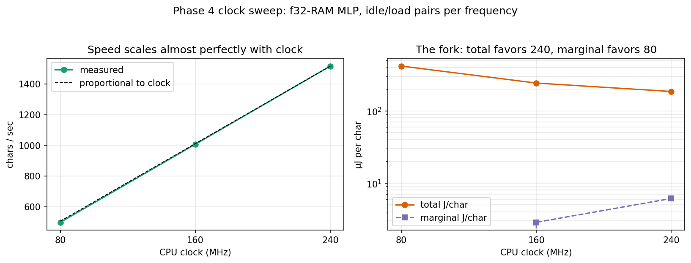
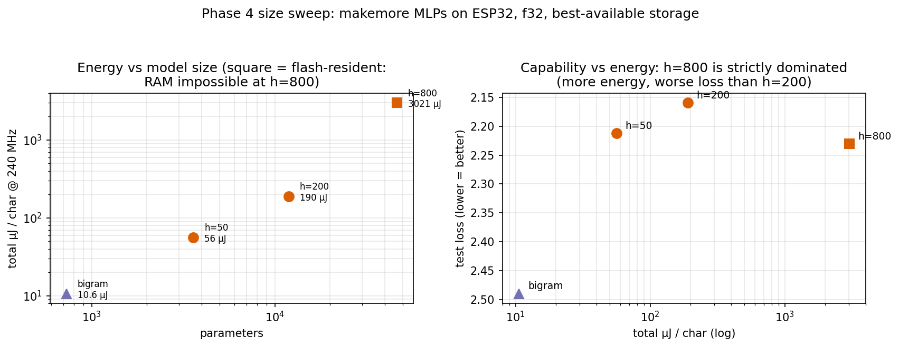
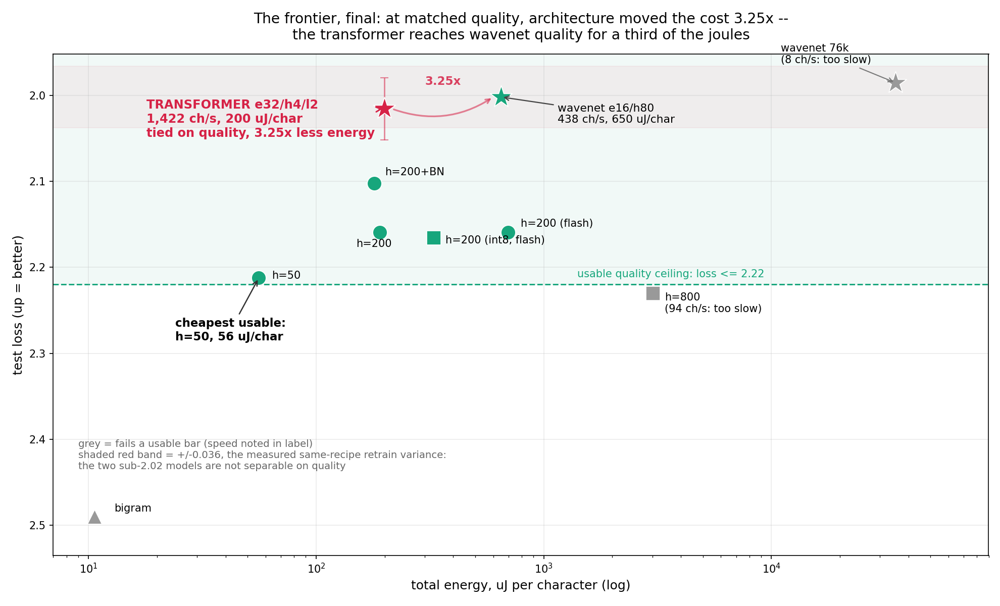
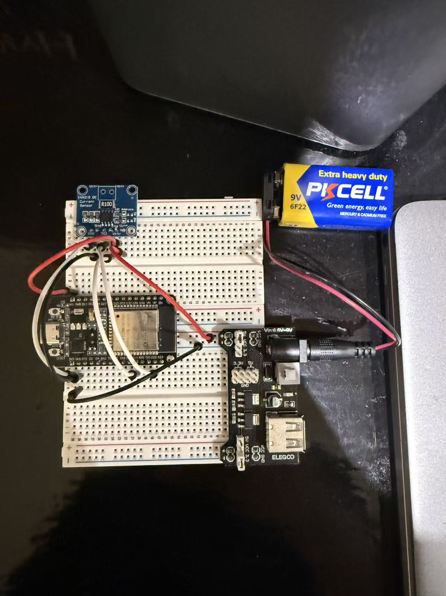
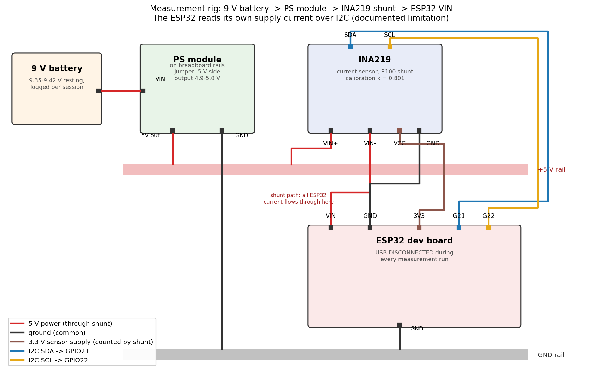

# How much energy does a language model cost, per character?

Measuring the energy cost of running small language models on a microcontroller. I am going all the way from a bigram lookup table to a trained MLP, with more to come in the future (batchnorm, attention, etc.). I hope find the cheapest hardware configuration that produces "usable" text generation. 

## The question

Big language models run in datacenters where energy is measured in megawatts. What does inference cost at the *bottom* of the hardware ladder. That is, a $10 microcontroller, and where does capability-per-joule stop being worth it? I measure joules per character across model types, quantization schemes, clock speeds, and model sizes on an ESP32, and define concretely what "usable" means later on.

I strongly believe that while the developments of large language models today are important, the real value of artificial intelligence lies in embodied AI, enabling robots and other systems by empowering them with intelligence. However, currently, calling a LLM through cloud API can be expensive and slow. The fix to this has to be local deployement of AI within these machines, which requires efficient compute and some sacrifice of capabilities. I hope to uncover what the modern architecture of AI cost on the energy level and understand the sacrifices made in lowering that cost.

## The rig

- ESP32 dev board (Elegoo kit), powered through an INA219 current sensor on the 5 V supply line
- The ESP32 reads its own supply current over I2C (documented limitation — see Error analysis)
- Breadboard power supply module → INA219 shunt → ESP32 VIN; all measurement runs with USB disconnected (single power source)
- Multimeter used as independent reference instrument and checker

<!-- TODO: wiring photo + diagram (Phase 8) -->

## Method

Power is sampled at 10 Hz for 10 s after a 5 s settle, WiFi/BT explicitly disabled. Energy per character = (mean power under load − idle baseline) / characters generated. All currents corrected by a measured calibration factor (see Instrument validation).

Here, the idle baseline is just the pure energy cost of running the esp32

## 1. Baseline: idle power vs CPU frequency

| CPU clock | Mean current | Bus voltage | Power | Std |
|---|---|---|---|---|
| 240 MHz | 56.36 mA | 4.982 V | 280.81 mW | ±5.23 mW |
| 160 MHz | 49.82 mA | 4.986 V | 248.39 mW | ±4.01 mW |
| 80 MHz  | 42.69 mA | 4.994 V | 213.17 mW | ±4.25 mW |

n = 100 samples per run, 10 Hz, corrected current (k = 0.801, see below).

Observations:
- Power decreases monotonically and near-linearly with clock: ~0.53 mW/MHz
- Naive linear extrapolation to 0 MHz suggests a fixed overhead floor of roughly 178 mW (LDO, power LED, peripherals, leakage) — ~63% of total power at 240 MHz. This is why all inference measurements are reported as deltas above baseline.
- Repeatability: runs taken on different occasions agree within ~1%.

## Instrument validation

Predicted current through a measured 220.0 Ω resistor at the measured rail voltage is roughly 22.7–22.9 mA according to ohm's law. Multimeter in series read 22.2 mA. The INA219 reported 27.70 mA — a +25% over-read.

Diagnosis: shunt confirmed R100 by marking; switching library calibration range (32V/2A → 16V/400mA) had no effect. Root cause undiagnosed (plausibly shunt tolerance or clone INA219 die); correction is empirical.

Fix: measured scale factor k = 22.2 / 27.70 = 0.801 applied to all current readings in software. Verified at a second load point (330 Ω: predicted 15.2 mA, corrected reading 15.0 mA, ~1.5% agreement) — gain correction is linear across 15–22 mA

## Error analysis

- **Two-source contamination:** with USB connected, current reads negative (reverse flow through the shunt). All measurements are USB-disconnected; positive current is a per-run validity check.
- **Calibration extrapolation:** calibration points span 15–22 mA; operating currents are 42–56 mA. Correction is assumed linear beyond the calibrated range. (Optional closure: a ~50 mA calibration point via 100 Ω load.)
- **Bus voltage vs rail:** INA219 bus voltage reads ~60 mV below the multimeter rail measurement — shunt drop plus breadboard contact resistance. The ESP32 sees slightly under 5 V.
- **Noise floor:** idle power std is ±4–6 mW (~2%). Inference deltas near this magnitude are at the edge of resolution.
- **Window length:** 10 s windows won't capture slow drifts (e.g. regulator warm-up). Spot-check longer runs if results look suspicious.
- **Self-power:** the INA219 is powered from the ESP32's 3.3 V rail, so its own ~1 mA draw flows through the shunt and is counted in every measurement, including baseline — it cancels in the delta.
- **Root cause of the 25% gain error remains unknown** — the correction is calibration, not explanation.

## 2. Bigram model (embedding/lookup floor)

The first model on the chip is the neural bigram from makemore video 1: a single 27×27 weight matrix trained to a loss of 2.4901, exported to a C header. Because the input is a one-hot vector, the "matmul" collapses to selecting one row of W — so this model measures the energy floor of lookup-based inference: one row read, a 27-wide softmax, and a sample per character.

| | |
|---|---|
| CPU clock | 240 MHz |
| Generation speed | 26,744 chars/sec |
| Mean power during generation | 283.78 ± 8.99 mW (std) |
| Idle baseline (same day, same wiring) | 280.55 ± 4.90 mW (std) |
| **Marginal energy** | **≈ 121 nJ/char** (± ~38 nJ statistical) |
| Total energy (baseline included) | ≈ 10.6 µJ/char |

The delta above idle is 3.23 mW — about 3.2σ against the combined standard error, so real but barely. The pre-registered expectation held: lookup inference is nearly free.

The sharper finding is the ratio between the two energy numbers. The *model* costs ~121 nJ/char; *keeping the chip awake* to run it costs ~10.6 µJ/char — roughly 100× more. At this floor, inference cost is dominated by the price of the processor existing, not the price of the computation. The question for the rest of the project is where that flips: as models grow, marginal cost should climb toward and past the awake-cost.

Caveats:
- The idle baseline calls `delay()`, which lets the RTOS idle between ticks; the inference loop never yields. The 3.23 mW delta therefore bundles "continuous compute" with "the model" — at this scale they are not separable.
- Generation uses a fixed-seed xorshift PRNG, so every run produces the identical character sequence; run-to-run power differences are rig noise, not workload variation.
- INA219 reads pause generation ~0.6 ms each at 10 Hz — a ~0.6% duty perturbation.
- Baseline stability check: 240 MHz idle re-measured on the day of this run gave 280.55 mW vs the original 280.81 mW (0.1% apart).

## 3. Matmul microbenchmark

Naive triple-loop matmul kernels, int8 (int32 accumulator) and float32, at N = 16/32/64, 240 MHz. Runtime matrix size (flat arrays, stride indexing), fixed-seed fill, volatile checksum sink to defeat dead-code elimination. Same measurement scaffold as Phase 1.

| Kernel | N | MMACs/sec | Total µJ/MMAC | Marginal µJ/MMAC |
|---|---|---|---|---|
| int8 | 16 | 11.30 | 25.3 | 0.44 ± 0.18 |
| int8 | 32 | 11.84 | 24.1 | 0.43 ± 0.16 |
| int8 | 64 | 12.11 | 23.6 | 0.47 ± 0.16 |
| f32 | 16 | 17.15 | 16.8 | 0.44 ± 0.14 |
| f32 | 32 | 18.35 | 15.6 | 0.32 ± 0.11 |
| f32 | 64 | 18.96 | 15.1 | 0.26 ± 0.10 |

Findings:

- **float32 beats int8 by ~1.6× in throughput — and therefore in energy per MAC.** The LX6 has a single-precision FPU (with fused multiply-add) but no SIMD; int8 data buys no parallelism, and each byte costs an extra sign-extension on load. On this chip, quantization to int8 buys *memory footprint only* and costs ~1.6× in speed and energy. This inverts the usual embedded-quantization narrative, which assumes vector units.
- **Power is workload-independent:** all six configs sit at 285.5–288.1 mW, overlapping within noise, and match the Phase 1 bigram run. What the CPU computes barely moves power; that it is computing is everything. Consequently total energy per task ≈ power × time, and the fastest configuration is presumptively the most efficient (to be tested directly in the clock sweep).
- **Throughput rises mildly with N** for both kernels (per-matmul overhead — loop setup and the N² checksum pass — amortizing away). No memory-wall downturn through N = 64.
- **Compiler effects are measurable:** the same f32/N=64 kernel ran 22.89 MMACs/s with compile-time-constant N vs 18.96 with runtime N (−17%); int8 moved only 12.89 → 12.11. Benchmark numbers are properties of the *build*, not just the algorithm. Sweep numbers (one consistent binary) are primary.

Caveats:
- Marginal deltas are 5–7.5 mW against a ±1 mW-scale SE and were measured against a morning baseline on a sagging battery supply (see incident log) — marginal µJ/MMAC values are indicative; total-power values are robust.
- Checksum pass adds ~1/N overhead (6% at N=16, 1.5% at N=64), included in the measurement.

## 4. MLP (makemore)

A simple MLP that takes the 3 previous characters as context when generating
the next. Architecture: 10-dim character embeddings C(27×10), hidden layer
W1(30×200) + b1 with tanh, output layer W2(200×27) + b2, no batchnorm for now.
11,897 parameters. Train loss 2.1193 / test loss 2.1593, vs the bigram's 2.49.
(Test loss of a *retrained* model varies slightly — batch sampling is unseeded —
but all numbers here come from the single trained instance exported to the chip.)

Sample of names generated **on the chip** (correctness witness, printed after
each measurement window): `camrockie. jalent. mir. maden. zya. kyrianna.
tamone. vann. levi. luccany. nastefarri. evang. damari.` These are quite name-like names.

### Quantization decision

Per-tensor symmetric int8, weights-only: weights stored as int8 with one float
scale per tensor, dequantized to float during the matmul (arithmetic stays
float32). Full-int8 arithmetic deferred to future works.

Why per-tensor: weight statistics showed no outliers (max/std between 2 and 5.5
for every tensor), so a single scale per tensor wastes little range. Confirmed
by measurement: test loss 2.1593 (float32) → 2.1655 (int8), a cost of
**+0.0062 (~0.3%)**. Memory: 47.6 KB → 11.9 KB.

### Pre-registered predictions

MAC count: 6,000 (W1) + 5,400 (W2) = 11,400 MACs/char (bias adds and embedding
lookups excluded; both negligible).

1. **Matmul-only ceiling:** Phase 2's f32 rate (18.96 MMACs/s) predicts
   ~1,660 chars/sec.
2. **Measured lands below the ceiling**, gap attributed to 200 tanh calls,
   softmax, and sampling per char; estimated ~1,100–1,500 chars/sec.

### What actually happened: the detective sequence

**First measurement: 410 chars/sec — 4× below the ceiling.** Prediction 2
failed badly; the pre-registered suspects (tanh/softmax) could not explain a
gap this large.

**Profiling** (per-char, µs): W1 matmul 1002 (43%), tanh 406 (17%),
W2 matmul 854 (36%), softmax+sample 82 (4%). The matmuls themselves were
running at ~6 MMACs/s — 3× slower than the identical arithmetic in Phase 2's
microbenchmark. The gap was *inside* the matmul, not around it.

**The int8 run moved the controls.** Weights-only int8 measured 864 chars/sec —
2.1× *faster* than float32, contradicting Phase 2's finding that int8
arithmetic is slower on this chip. And in its profile, tanh and softmax — which
touch no weights — sped up too (406→357, 82→37 µs). Something *shared* got
faster when the weights shrank.

**Mechanism:** `const` arrays on the ESP32 live in flash, accessed through a
small flash cache. The 45.6 KB float32 weights overflow it and thrash — evicting,
among other things, the lookup tables libm's `tanhf`/`expf` rely on, which is
why the "controls" moved. The 11.9 KB int8 weights fit. Phase 2's matrices were
filled at runtime and therefore lived in **RAM** (single-cycle SRAM, no cache
involved) — the microbenchmark had silently measured a different memory tier
than the deployed model used.

**Confirmation experiment (pre-registered):** copy the float32 weights to RAM
at startup, change nothing else. Predicted a return toward the ceiling;
measured **1,518 chars/sec** — 91% of ceiling, 3.7× the flash version.
Completing the square, int8-in-RAM measured 866 — identical to int8-in-flash
(864), confirming the int8 weights were never cache-limited; their remaining
~1.75× gap to f32-RAM is the dequantization tax (an int8 load, sign-extension,
and scale-multiply per weight, fully exposed on the critical path once memory
stalls are gone), closely matching Phase 2's integer-kernel ratio (1.57×).

### Result: same model, four storage configurations

| Config | chars/sec | Total energy/char | Weights |
|---|---|---|---|
| float32, flash | 410 | 697 µJ | 45.6 KB (thrashes flash cache) |
| int8, flash | 864 | 329 µJ | 11.9 KB (fits cache) |
| int8, RAM | 866 | 336 µJ | conversion-tax bound |
| **float32, RAM** | **1,518** | **191 µJ** | best configuration |

(Marginal-above-baseline energies are omitted from this table: mean power
wandered 284–291 mW across these runs — the unexplained supply drift — which
swamps 5–10 mW deltas. Total-power energies are robust to it.)

**The finding: memory tier beats number format.** Quantization looked 2×
faster, but only because it shrank the working set under the flash-cache
threshold; float32 with weights in RAM beats it by 1.8×. On this chip,
quantization costs energy unless the model doesn't fit — and "fits" has two
thresholds (flash cache, then RAM), each with its own price. The exact
flash-cache threshold between 11.9 and 45.6 KB is unmeasured (bracketing it is
future work).

### Cross-check verdict

Phase 2's J/MMAC numbers under-predicted flash-resident energy by 4× and
predicted RAM-resident speed within 9%. The microbenchmark was accurate — for
the memory tier it silently measured. A microbenchmark's fine print (where its
data lives) can matter more than the quantity it reports.

Capability-per-joule datapoint: going bigram → MLP bought 0.33 nats of loss
(2.49 → 2.16) for ~18× the total energy per char (10.6 → 191 µJ, best configs).
The awake-cost still dominates marginal compute even at this size.

## 5. Sweeps

### 5a. Quantization / storage sweep

Completed in section 4: the same MLP across {float32, int8} × {flash, RAM}.
One-sentence insight: **memory tier dominates number format — float32-in-RAM
is the best configuration, and int8's apparent 2× win was a cache effect.**

### 5b. Clock sweep

The race-to-idle question: does lowering the clock save energy per character,
or just stretch the fixed costs over more time? Protocol: idle/load pairs at
each frequency, measured back-to-back in one session (the supply drift makes
cross-session marginal deltas untrustworthy — see incident log), f32-RAM
configuration, identical generated character sequence at each clock
(reseeded RNG).

Pre-registered predictions: total J/char → 240 MHz wins; marginal J/char →
80 MHz wins; speed scales proportionally with clock. All three held.

| Clock | chars/sec | P idle | P load | Marginal J/char | Total J/char |
|---|---|---|---|---|---|
| 240 MHz | 1,517 | 272.53 mW | 281.80 mW | 6.1 µJ | **186 µJ** |
| 160 MHz | 1,007 | 241.92 mW | 244.80 mW | 2.9 µJ | 243 µJ |
| 80 MHz | 498 | 208.83 mW | 208.32 mW | ~0 (below noise) | 418 µJ |

Findings:

- **Speed scales almost perfectly with clock** (measured 1007/498 vs 1011/506
  predicted for proportional) — the workload is purely CPU-bound; RAM-resident
  weights insulated it from memory-timing effects.
- **The fork: "which clock is best" has no answer until you specify the
  accounting.** If the chip exists to generate text, run it at 240 MHz —
  race-to-idle wins, because the ~180 mW fixed floor gets charged over 3× the
  time at 80 MHz (186 vs 418 µJ/char). If generation piggybacks on a chip that
  must be awake anyway, run at 80 MHz, where inference is *marginally free* —
  load power was statistically indistinguishable from idle (−0.5 ± ~0.5 mW).
- **Open observation:** marginal power falls super-linearly with clock
  (9.3 → 2.9 → ~0 mW; proportional would give 9.3 → 6.2 → 3.1). Mechanism not
  isolated; candidates include nonlinear compute-vs-idle power gaps at low
  clock and measurement-floor effects. Claims built on the marginal column
  carry this caveat.

Same-session idle baselines came out ~7 mW below Phase 0's (coherently across
all three clocks) — consistent with the additive supply drift; per-frequency
pairing absorbs it.

### 5c. Model size sweep

Three MLPs, identical architecture and training recipe (200k steps, same LR
schedule, no regularization tuning — size is the only variable), hidden width
50 / 200 / 800. All measured at 240 MHz, f32, best-available storage per size.

Pre-registered: hidden-50 ≈ 4,500 chars/sec (measured 5,110), hidden-800
≈ 400 chars/sec *for a RAM-resident run that turned out to be impossible*;
total J/char ordering 50 < 200 < 800 (held).

**The RAM wall, located.** Hidden-800's weights (185.7 KB float32) exceed this
chip's RAM by every route: static allocation fails at link time (DRAM segment
overflowed by 113 KB) and heap allocation of the two weight matrices fails at
runtime (malloc returns NULL). Its only life on this chip is flash-resident —
streaming 186 KB per character through the small flash cache. The measured 94
chars/sec is therefore "best achievable at this size," which is the
deployment-relevant number. On this chip, **the model that overfits also
doesn't fit.**

| Hidden | Params | Test loss | Storage | chars/sec | Total J/char |
|---|---|---|---|---|---|
| — (bigram) | 729 | 2.49 | flash | 26,744 | 10.6 µJ |
| 50 | 3,597 | 2.2123 | RAM | 5,110 | 56 µJ |
| 200 | 11,897 | 2.1593 | RAM | 1,517 | 190 µJ |
| 800 | 46,427 | 2.2306 | flash (RAM impossible) | 94 | 3,021 µJ |

Findings:

- **Hidden-800 is strictly dominated: 16× the energy of hidden-200 for worse
  test loss.** Two independent failures compound — it overfits (train 2.1304
  vs test 2.2306; ~180k training examples can't feed 46k params under this
  recipe) and it pays the flash-thrash tax because it can't fit in RAM.
  "Bigger is better" fails twice on this rig.
- **Diminishing returns arrive early:** the first ~3k params buy 0.28 nats
  over the bigram; the next 8.3k buy 0.05; the next 34k buy negative.
- **Hidden-50 is the efficiency sweet spot candidate:** 89% of hidden-200's
  quality gain at 29% of its energy (56 vs 190 µJ/char). Whether it or
  hidden-200 "wins" depends entirely on where the usable line sits — Phase 6's
  question, deliberately not answered here.
- Energy spans 54× across a 13× parameter range — super-linear at the top
  because crossing the RAM wall adds the thrash tax on top of the MAC count.

Caveats: unseeded training means test losses carry run-to-run variance of
order ±0.02–0.04 (observed directly: two same-recipe hidden-800 trainings
differed by 0.036); all numbers are from the single exported instance of each
size. The hidden-800 row mixes storage config with size by necessity, flagged
in the chart (square marker).

## 6. What counts as "usable," and what it costs

### The definition (fixed before the frontier was drawn)

**Speed floor: 400 chars/sec.** Derived from a task: a name-suggestion service
with < 100 ms perceived latency. Average name ≈ 6 characters → 60 chars/sec
per user; sized for a handful of concurrent users (a classroom pod) → 400.
(Serving individual requests adds no meaningful overhead on this rig — no
network in the loop — so continuous-generation chars/sec transfers directly.)

**Quality ceiling: test loss ≤ 2.22.** Drawn by reading the outputs: the
bigram's samples (`cexze`, `xzindaneriah`) are not names; hidden-50's
(`isla`, `ariannah`, `mauston`) and hidden-200's (`kyrianna`, `levi`, `quinn`)
are. Hidden-800 (2.2306) falls just outside, and inspection agrees — its
output mixes plausible names with memorization artifacts. The hidden-800 model clearly is overfitting on the training data

This definition is task-relative (name-likeness on this dataset) and
versioned: better training (batchnorm, careful init, attention) would raise
the capability ceiling and justify redrawing a stricter line — see Future
work.

### The frontier

| Config | Test loss | chars/sec | Total J/char | Usable? |
|---|---|---|---|---|
| bigram, flash | 2.49 | 26,744 | 10.6 µJ | ✗ quality |
| **h=50, f32-RAM** | **2.2123** | **5,110** | **56 µJ** | **✓ cheapest** |
| h=200+BN (folded), f32-RAM | 2.1025 | 1,577 | 180 µJ | ✓ |
| h=200, f32-RAM | 2.1593 | 1,517 | 190 µJ | ✓ |
| h=200, f32-flash | 2.1593 | 410 | 697 µJ | ✓ (marginal on speed) |
| h=200, int8-flash | 2.1655 | 864 | 329 µJ | ✓ |
| h=800, flash | 2.2306 | 94 | 3,021 µJ | ✗ quality and speed |
| wavenet e16/h80, f32-RAM | 2.0019 | 438 | 650 µJ | ✓ (best usable quality) |
| wavenet 76k, flash | 1.9853 | 8 | 35,100 µJ | ✗ speed |

### Verdict

The cheapest configuration that clears the bar is the **hidden-50 MLP,
float32, RAM-resident, at 240 MHz: 56 µJ per character — about 0.34 mJ per
generated name** — running on hardware totaling roughly $15–25 (ESP32 dev
board ~$10 (varies depending on supplier), INA219 measurement sensor ~$2–5; the sensor is rig, not product,
so the deployed answer is "a $10 board"). 
For scale: a 9 V battery (~18 kJ) sustains ~18 hours of continuous generation,
or ~50 million names counting only marginal compute.

Three structural facts shaped the frontier more than any smooth trade-off:
the awake-power floor (making speed the dominant energy lever), the flash
cache boundary (~12–45 KB), and the RAM wall (~48–186 KB). On this chip, the
capability-per-joule question is answered less by the model's arithmetic than
by which memory tier it fits.

## Incident log

- **Negative current with USB attached** — symptom: −19 mA at idle; measurement: sign flip on USB disconnect; cause: two active power sources, USB backfeeding through the shunt path; fix: USB-disconnected protocol, positive-current validity check.
- **INA219 +25% over-read** — symptom: 27.7 mA on a 22.9 mA predicted load; measurement: multimeter series reference at two load points; cause: undiagnosed gain error (shunt marking correct, calibration range irrelevant); fix: empirical scale factor 0.801, linear-verified.

- **Supply drift on 9 V battery rail** — symptom: bus voltage wandered 4.84–4.98 V across sessions (both directions); initial suspect (battery discharge) was *acquitted* by direct terminal measurement (9.35–9.42 V resting across sessions, well above the module's 6.5 V minimum); remaining suspects: breadboard contact resistance, regulator behavior; status: cause not isolated. Mitigations: battery voltage logged per session (power_log.md), runs gated on ≥ ~7.5 V, and analyses lean on total-power energies (robust to small power offsets) rather than marginal deltas where the drift matters.

- **Out-of-distribution context at word boundaries (MLP port)** — symptom: generated names overwhelmingly began with e/i/h, unlike Colab samples; measurement: witness-text comparison against notebook output; cause: chip loop never reset context after sampling `.`, feeding the model `[prev, prev, 0]` states it never saw in training; fix: context reset to `[0,0,0]` on word boundary. Energy numbers were unaffected (same MACs either way) — only the correctness witness caught it.
- **`const` weights live in flash; microbenchmark measured RAM** — symptom: MLP matmuls ran 3× slower than Phase 2's identical arithmetic; localization: profiling put 79% of runtime in the matmuls themselves; key clue: the int8 run sped up tanh and softmax, which touch no weights — a shared resource (flash cache) was being thrashed by the 45.6 KB float weights and recovered when weights shrank to 11.9 KB; confirmation: copying float32 weights to RAM restored 91% of the predicted ceiling (410 → 1,518 chars/sec). Phase 2's runtime-filled matrices had silently lived in RAM all along.

- **Loose connection during size sweep** — symptom: bus voltage 4.506 V (vs normal 4.83–4.99 band), power std 4× normal; cause: improperly seated supply connection; fix: reseat, rail recovered to 4.930 V. Forensic detail: the bad run and the rerun differed by exactly 1 character in 50,599 and produced character-identical witness text after the first name — deterministic compute was provably unaffected while the supply flailed; speed numbers and power numbers have independent failure modes.
- **Hidden-800 exceeds RAM by every route** — static allocation: linker DRAM segment overflowed by 113 KB; heap allocation: malloc of the two weight matrices (96 + 86 KB) returned NULL (SOS blink). RAM ceiling for model weights located empirically between 48 KB (hidden-200, fits with room) and 186 KB (impossible). Fallback: flash-resident measurement, accepted as the "best achievable at this size" datapoint.

## What surprised me

In this project, I found many surprises. First, the fact that the INA219 measured 25% off by the multimeter. This was a big surprise. Another surprise is how little running the bigram model actually costs compared to just keeping the chip awake (idel cost). Initially, I thought all the matrix multiplication and lookup would surely cost a lot more than just keeping the chip awake. Turns out not. 

## Reproducibility

The code, as well as the notebooks to train the respective models are found in there respective folders. The weights are also attached

To run the benchmarks, simply upload, pull the usb out, power cycle the chip, and re-plug once the measuring is done as indicated by the on-chip LED

## Future Work

Here is a list of potential future stuff to work on that I have considered
- IMplement batchnorm (done), attention, etc. to see how they would affect performance vs. cost
- Use a ESP32-S3 to run bigger models as well as SIMD support to see int8 vs f32 again
- Full int8 arithmetics as promised

### Update 1: batchnorm + proper init

Retrained MLP hidden-200 with batchnorm and proper initialization (makemore video 3, including making output layer not overconfident):
train 2.0617 / test 2.1025: a 0.057 improvement over the plain MLP at zero added parameters.

Batchnorm was **folded into W1/b1 before export**: at inference, BN with running
statistics is constant per-neuron arithmetic (scale by gain/std, shift by the
folded bias), so it compiles away entirely — the exported model has the same
shapes as the plain MLP and runs on the identical sketch. Folding verified
exact in Colab (folded test loss matches unfolded to 4 decimals). This is
standard deployment practice (TensorRT/TFLite do it automatically); LayerNorm,
used in transformers, cannot be folded — its statistics depend on the live
activations — which will matter if attention ever lands on this chip.

Measured (240 MHz, f32-RAM): **1,577 chars/sec, 180 µJ/char total** — vs the
plain MLP's 1,517 and 190. Same shapes and arithmetic, so the 4% speed
difference is treated as run variation (plausibly data-dependent expf/tanhf
timing), not a batchnorm speedup. The honest claim: **quality up 0.057 nats,
inference cost unchanged.**

The usable line stays at 2.22: it was derived from reading outputs, and the
outputs it admits haven't changed. The verdict is therefore unchanged —
hidden-50 remains cheapest-usable — while best-available quality moves to
BN-h=200 at 180 µJ/char.

### Update 2: wavenet — architecture vs the memory envelope

Trained the makemore wavenet (hierarchical context, block_size 8: three levels
of pairwise merging instead of one flat concat) in two sizes, all batchnorms
folded before export (verified exact), measured on the same protocol.

**As-published size (e=24, h=128, 76,579 params ≈ 306 KB):** test loss 1.9853 —
the best quality of any model in this project. On the chip it is flash-only
(1.6× past the measured RAM wall) and runs at **8 chars/sec, 35.1 mJ/char** —
50× below the usable floor. Two observations from this run: mean power was the
*lowest* of any compute run (277.5 mW vs the usual ~285) — a memory-stall-bound
core draws less than a computing one, so being slow doesn't even buy
proportional power savings; and at ~127 ms/char the 10 Hz sampling protocol
degrades to one sample per character (window stretched to 12.65 s; the J/char
arithmetic uses actual elapsed time and is unaffected).

**Sized to the memory envelope (e=16, h=80, ~31k params ≈ 125 KB, RAM-resident):**
train 1.8653 / val 2.0015 / test 2.0019. Measured **438 chars/sec, 650 µJ/char**
— it clears both usable bars, the quality bar easily and the speed floor by
9.5%. That margin is thin: any added load, lower clock, or feature would sink
it below 400.

**This falsifies an earlier conclusion.** Section 6 previously claimed
everything above h=200 quality was unreachable at usable speed on this
hardware. It was unreachable by *scaling* — h=800 and the 76k wavenet both die
on the memory walls — but reachable by *architecture sized to the hardware*:
the same wavenet family at 2.4× fewer parameters moves from 8 chars/sec to
438. On this chip, designing to the memory envelope beat naive scale.

Registration record, kept honestly: the 76k speed was registered (20–35
chars/sec predicted; measured 8 — flash thrash at 2× the previous worst
working set is catastrophically nonlinear, not proportional). The e16/h80
speed was not pre-registered before its run — the only measurement in the
project that skipped the ritual.

Standings after this update: cheapest usable unchanged (h=50, 56 µJ/char);
best usable quality: wavenet e16/h80 at 2.0019 and 650 µJ/char; best quality
at any speed: wavenet 76k at 1.9853, unusable.

### Update 3: attention — architecture at matched memory

Trained a small GPT (the makemore/nanoGPT architecture: causal self-attention,
LayerNorm, residual stream, ReLU feedforward) and ported it with a KV cache.

**Sizing decision.** The model was matched to the *memory envelope*, not to a
parameter count: n_embd 32, 4 heads, 2 layers, block_size 16 → 27,547 params ≈
110.2 KB float32, against the wavenet e16/h80's 125 KB. Matching parameters to
the MLP instead (~11k) would have made a transformer lose to a wavenet 2.8×
its size and told me nothing about attention. block_size 16 covers the longest
name in the dataset (15 characters), so the model never needs a sliding window
and position is absolute within a name.

Train 1.8?? / val 2.0147 / **test 2.0155**.

<!-- Kevin: fill in the train loss from your run's final line. -->

**Result: 1,422 chars/sec, 199.8 µJ/char** (240 MHz, f32-RAM, 14,076 chars over
a 9.902 s window, 284.03 ± 8.57 mW, bus 4.886 V, 2,005 names, mean 7.02
chars/name, 0 truncations).

| Model | Params | KB | Test loss | chars/sec | Total J/char |
|---|---|---|---|---|---|
| wavenet e16/h80 | ~31k | 125 | 2.0019 | 438 | 650 µJ |
| **transformer e32/h4/l2** | **27,547** | **110** | **2.0155** | **1,422** | **200 µJ** |

**The finding: at quality that is not separable, architecture bought 3.25× in
energy.** The two models differ by 0.0136 nats — well inside the ±0.036
same-recipe retrain variance measured in the size sweep — so on this dataset
they are a tie on quality. They are not a tie on cost. Attention did not buy
capability here; it bought throughput, by needing far less arithmetic and far
fewer transcendental calls to reach the same place.

Where the speed comes from, mechanically: the wavenet evaluates 80 hidden units
at 7 positions across three levels, so 560 `tanhf` calls per character. The
transformer evaluates one new position per character and reuses the rest from
the KV cache, and its nonlinearity is ReLU — leaving roughly 59 `expf`
(attention softmaxes plus the output softmax) and 5 `sqrtf` (LayerNorm) per
character. Phase 3 measured tanh at 17% of runtime; that line item is now
essentially gone.

**LayerNorm, revisited.** Update 1 noted that BatchNorm folds away at inference
but LayerNorm cannot, "which will matter if attention ever lands on this chip."
It landed, and it did not matter much: five live LayerNorms per character, each
a mean, a variance and one `sqrtf` over 32 elements. The prediction was correct
in mechanism and wrong in magnitude — the arithmetic it adds is negligible
next to what ReLU removed.

**Something new: per-character cost is no longer constant.** Attention scores
are computed against every previous character in the current name, so a
character at position 12 costs more than one at position 2. Every prior model
in this project had a fixed per-character cost. The fixed-window protocol
averages over this silently, which is why the sketch now also logs names
generated and mean characters per name (7.02 here, against a dataset mean of
~6 characters plus the end token — an independent check that generation is
producing whole, correctly terminated names).

**Open observation: the model runs about twice as fast as Phase 2 says it can.**
Per character this model does roughly 25,700 MACs (3,072 qkv + 1,024 output
projection + 8,192 feedforward per layer, ×2, plus ~290 attention and 864
output head, at the measured mean position). At 1,422 chars/sec that is
**36.6 MMACs/sec** — nearly double Phase 2's float32 ceiling of 18.96, and
double what the MLP realized in the same memory tier with the same arithmetic.
Removing tanh cannot explain exceeding a matmul-only ceiling.

One candidate mechanism, untested: the q/k/v projections share a single load of
the input and accumulate into three independent registers, giving the FPU three
independent dependency chains to interleave, where Phase 2's kernel and the
MLP's matmuls each had one. A latency-bound accumulator chain and a
throughput-bound one are different machines. This is a suspect, not a
conclusion — isolating it means timing the feedforward loops (single
accumulator, structurally identical to the MLP's) separately from the fused
q/k/v loop.

**What this does to the Phase 2 model, either way.** The microbenchmark has now
failed in both directions: it under-predicted flash-resident energy by 4× in
Phase 3, and it over-predicts time by ~2× here. Its J/MMAC number is not a
portable cost model for this chip. MAC count predicts cost only once loop
structure and memory tier are held fixed — and both of those turned out to be
larger effects than the quantity the benchmark was built to measure.

**Correctness protocol, upgraded.** Previous ports were validated by reading the
generated names — which caught the Phase 3 word-boundary bug, but only because
that bug happened to be visible in text. This port was validated numerically:
the export script runs a NumPy forward pass built only from the exported
arrays, bakes the resulting logits for a fixed 4-token sequence into the C
header, and the sketch compares its own output against them at boot. Measured
agreement: **8.9e-08 max absolute error**, which is float32 rounding. The
KV-cached C path is arithmetically identical to the PyTorch model. Both the
head-fusion and the transposition in the exporter are covered by this check.

**Registration record.** Loss was pre-registered at 1.98–2.05; measured 2.0155,
inside the range. Speed was pre-registered at ~500 chars/sec; measured 1,422 —
a 2.8× miss in the same direction as Phase 3's, and for a related reason
(a cost model that ignores how the arithmetic is arranged).

<!-- Kevin: if you registered your own number before flashing, put it here —
     the record should show both guesses like the earlier phases do. -->

**Caveats.**
- One training seed per architecture. The 0.0136 loss gap is a third of the
  measured retrain variance and cannot be called a win in either direction.
- The transformer got best-val checkpoint selection and exact full-split
  evaluation; the wavenet number came from a fixed-step notebook run. The
  protocol asymmetry favours the transformer and it still did not win on loss.
- Marginal J/char is not reported: it needs a same-session idle pair, and the
  bus sat at 4.886 V (mid-band for the supply drift). Total-power energy is
  robust to that; the marginal number would not be.
- 27,547 params vs ~31k is a 12% memory advantage to the transformer, not an
  exact match.

---

### Section 6 replacement table

| Config | Test loss | chars/sec | Total J/char | Usable? |
|---|---|---|---|---|
| bigram, flash | 2.49 | 26,744 | 10.6 µJ | ✗ quality |
| **h=50, f32-RAM** | **2.2123** | **5,110** | **56 µJ** | **✓ cheapest** |
| h=200+BN (folded), f32-RAM | 2.1025 | 1,577 | 180 µJ | ✓ |
| h=200, f32-RAM | 2.1593 | 1,517 | 190 µJ | ✓ |
| **transformer e32/h4/l2, f32-RAM** | **2.0155** | **1,422** | **200 µJ** | **✓ best quality-per-joule** |
| h=200, int8-flash | 2.1655 | 864 | 329 µJ | ✓ |
| wavenet e16/h80, f32-RAM | 2.0019 | 438 | 650 µJ | ✓ |
| h=200, f32-flash | 2.1593 | 410 | 697 µJ | ✓ (marginal on speed) |
| h=800, flash | 2.2306 | 94 | 3,021 µJ | ✗ quality and speed |
| wavenet 76k, flash | 1.9853 | 8 | 35,100 µJ | ✗ speed |

Verdict amendment: cheapest usable is unchanged (h=50, 56 µJ/char). Best usable
quality is now a two-way tie the measurement cannot separate — and the cheaper
of the two costs a third as much, so the honest statement is that the
best *quality-per-joule* configuration on this chip is the transformer at
200 µJ/char, running 3.6× above the usable speed floor rather than 9.5% above
it.

### Future work — revised

- Isolate the >ceiling matmul rate: time the feedforward loops separately from
  the fused q/k/v loop. If the feedforward alone runs near 17 MMACs/s, loop
  structure is the mechanism and Phase 2's ceiling was a property of its
  kernel's shape, not the chip's.
- Multiple seeds per architecture, so the wavenet/transformer comparison can be
  stated as a tie with a confidence interval rather than a caveat.
- ESP32-S3: with the transcendental tax largely removed, this model is closer to
  pure matmul than anything else measured here, making it the cleanest possible
  test of what SIMD buys.
- Full int8 arithmetic, still owed.