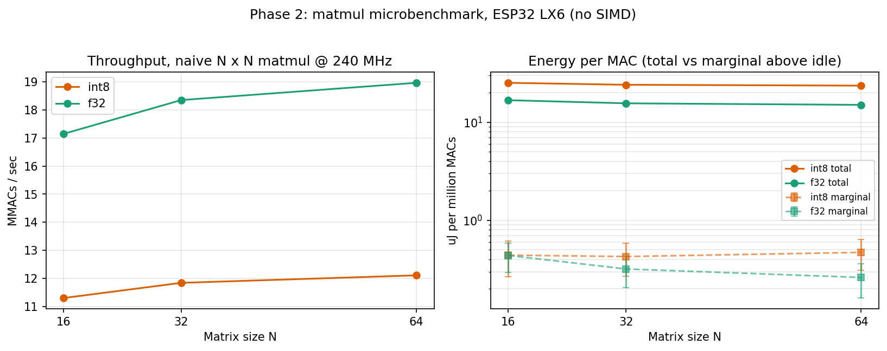
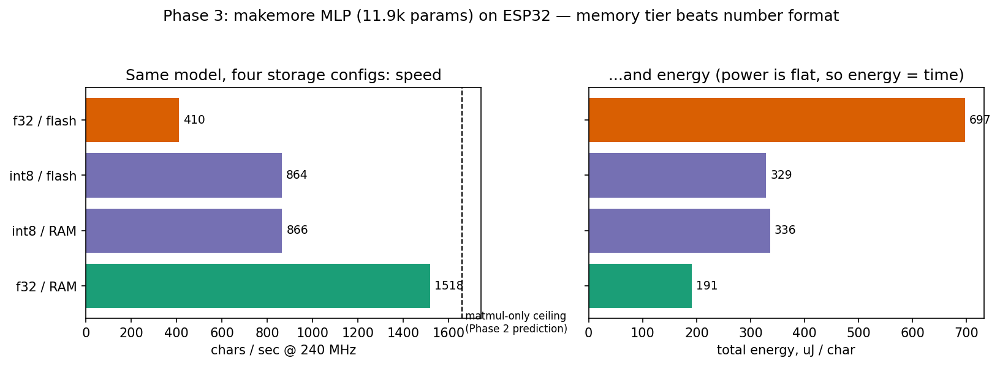

# How much energy does a language model cost, per character?

Measuring the energy cost of running small language models on a microcontroller — from a bigram lookup table to a trained MLP — to find the cheapest hardware configuration that produces "usable" text generation.

<!-- ^ First paragraph must work for a non-engineer reader. Rewrite in your own words. -->

## The question

Big language models run in datacenters where energy is measured in megawatts. What does inference cost at the *bottom* of the hardware ladder — a $10 microcontroller — and where does capability-per-joule stop being worth it? I measure joules per character across model types, quantization schemes, clock speeds, and model sizes on an ESP32, and define concretely what "usable" means.

<!-- Yours to rewrite. This framing is a placeholder. -->

## The rig

- ESP32 dev board (Elegoo kit), powered through an INA219 current sensor on the 5 V supply line
- The ESP32 reads its own supply current over I2C (documented limitation — see Error analysis)
- Breadboard power supply module → INA219 shunt → ESP32 VIN; all measurement runs with USB disconnected (single power source)
- Multimeter used as independent reference instrument

<!-- TODO: wiring photo + diagram (Phase 8) -->

## Method

Power is sampled at 10 Hz for 10 s after a 5 s settle, WiFi/BT explicitly disabled. Energy per character = (mean power under load − idle baseline) ÷ characters generated. All currents corrected by a measured calibration factor (see Instrument validation).

<!-- One sentence justifying each protocol choice: settle time, sample rate, window length, idle definition. Yours. -->

## 1. Baseline: idle power vs CPU frequency

| CPU clock | Mean current | Bus voltage | Power | Std |
|---|---|---|---|---|
| 240 MHz | 56.36 mA | 4.982 V | 280.81 mW | ±5.23 mW |
| 160 MHz | 49.82 mA | 4.986 V | 248.39 mW | ±4.01 mW |
| 80 MHz  | 42.69 mA | 4.994 V | 213.17 mW | ±4.25 mW |

n = 100 samples per run, 10 Hz, corrected current (k = 0.801, see below).

Observations:
- Power decreases monotonically and near-linearly with clock: ~0.53 mW/MHz
- Naive linear extrapolation to 0 MHz suggests a fixed overhead floor of roughly 178 mW (LDO, power LED, peripherals, leakage) — ~63% of total power at 240 MHz. This is why all inference measurements are reported as deltas above baseline.
- Repeatability: runs taken on different occasions agree within ~1%.

<!-- The extrapolated floor is a 3-point linear fit, not a measurement — keep that framing. -->

## Instrument validation

Predicted current through a measured 220.0 Ω resistor at the measured rail voltage: 22.7–22.9 mA. Multimeter in series read 22.2 mA. The INA219 reported 27.70 mA — a +25% over-read.

Diagnosis: shunt confirmed R100 by marking; switching library calibration range (32V/2A → 16V/400mA) had no effect. Root cause undiagnosed (plausibly shunt tolerance or clone INA219 die); correction is empirical.

Fix: measured scale factor k = 22.2 / 27.70 = 0.801 applied to all current readings in software. Verified at a second load point (330 Ω: predicted 15.2 mA, corrected reading 15.0 mA, ~1.5% agreement) — gain correction is linear across 15–22 mA.

<!-- Yours: write this as a paragraph in your own words. The % disagreement number is the checklist requirement. -->

## Error analysis

- **Two-source contamination:** with USB connected, current reads negative (reverse flow through the shunt). All measurements are USB-disconnected; positive current is a per-run validity check.
- **Calibration extrapolation:** calibration points span 15–22 mA; operating currents are 42–56 mA. Correction is assumed linear beyond the calibrated range. (Optional closure: a ~50 mA calibration point via 100 Ω load.)
- **Bus voltage vs rail:** INA219 bus voltage reads ~60 mV below the multimeter rail measurement — shunt drop plus breadboard contact resistance. The ESP32 sees slightly under 5 V.
- **Noise floor:** idle power std is ±4–6 mW (~2%). Inference deltas near this magnitude are at the edge of resolution.
- **Window length:** 10 s windows won't capture slow drifts (e.g. regulator warm-up). Spot-check longer runs if results look suspicious.
- **Self-power:** the INA219 is powered from the ESP32's 3.3 V rail, so its own ~1 mA draw flows through the shunt and is counted in every measurement, including baseline — it cancels in the delta.
- **Root cause of the 25% gain error remains unknown** — the correction is calibration, not explanation.

<!-- Expand each bullet to a sentence or two in your voice. -->

## 2. Bigram model (embedding/lookup floor)

The first model on the chip is the neural bigram from makemore video 1: a single 27×27 weight matrix trained to a loss of 2.4901, exported to a C header. Because the input is a one-hot vector, the "matmul" collapses to selecting one row of W — so this model measures the energy floor of lookup-based inference: one row read, a 27-wide softmax, and a sample per character.

| | |
|---|---|
| CPU clock | 240 MHz |
| Generation speed | 26,744 chars/sec |
| Mean power during generation | 283.78 ± 8.99 mW (std) |
| Idle baseline (same day, same wiring) | 280.55 ± 4.90 mW (std) |
| **Marginal energy** | **≈ 121 nJ/char** (± ~38 nJ statistical) |
| Total energy (baseline included) | ≈ 10.6 µJ/char |

The delta above idle is 3.23 mW — about 3.2σ against the combined standard error, so real but barely. The pre-registered expectation held: lookup inference is nearly free.

The sharper finding is the ratio between the two energy numbers. The *model* costs ~121 nJ/char; *keeping the chip awake* to run it costs ~10.6 µJ/char — roughly 100× more. At this floor, inference cost is dominated by the price of the processor existing, not the price of the computation. The question for the rest of the project is where that flips: as models grow, marginal cost should climb toward and past the awake-cost.

Caveats:
- The idle baseline calls `delay()`, which lets the RTOS idle between ticks; the inference loop never yields. The 3.23 mW delta therefore bundles "continuous compute" with "the model" — at this scale they are not separable.
- Generation uses a fixed-seed xorshift PRNG, so every run produces the identical character sequence; run-to-run power differences are rig noise, not workload variation.
- INA219 reads pause generation ~0.6 ms each at 10 Hz — a ~0.6% duty perturbation.
- Baseline stability check: 240 MHz idle re-measured on the day of this run gave 280.55 mW vs the original 280.81 mW (0.1% apart).

<!-- EDIT PASS REQUIRED: rewrite at least the two interpretation paragraphs
     ("The delta above idle..." and "The sharper finding...") in your own words.
     These are the sentences you'll be asked about. -->

## 3. Matmul microbenchmark

Naive triple-loop matmul kernels, int8 (int32 accumulator) and float32, at N = 16/32/64, 240 MHz. Runtime matrix size (flat arrays, stride indexing), fixed-seed fill, volatile checksum sink to defeat dead-code elimination. Same measurement scaffold as Phase 1.

| Kernel | N | MMACs/sec | Total µJ/MMAC | Marginal µJ/MMAC |
|---|---|---|---|---|
| int8 | 16 | 11.30 | 25.3 | 0.44 ± 0.18 |
| int8 | 32 | 11.84 | 24.1 | 0.43 ± 0.16 |
| int8 | 64 | 12.11 | 23.6 | 0.47 ± 0.16 |
| f32 | 16 | 17.15 | 16.8 | 0.44 ± 0.14 |
| f32 | 32 | 18.35 | 15.6 | 0.32 ± 0.11 |
| f32 | 64 | 18.96 | 15.1 | 0.26 ± 0.10 |

Findings:

- **float32 beats int8 by ~1.6× in throughput — and therefore in energy per MAC.** The LX6 has a single-precision FPU (with fused multiply-add) but no SIMD; int8 data buys no parallelism, and each byte costs an extra sign-extension on load. On this chip, quantization to int8 buys *memory footprint only* and costs ~1.6× in speed and energy. This inverts the usual embedded-quantization narrative, which assumes vector units.
- **Power is workload-independent:** all six configs sit at 285.5–288.1 mW, overlapping within noise, and match the Phase 1 bigram run. What the CPU computes barely moves power; that it is computing is everything. Consequently total energy per task ≈ power × time, and the fastest configuration is presumptively the most efficient (to be tested directly in the clock sweep).
- **Throughput rises mildly with N** for both kernels (per-matmul overhead — loop setup and the N² checksum pass — amortizing away). No memory-wall downturn through N = 64.
- **Compiler effects are measurable:** the same f32/N=64 kernel ran 22.89 MMACs/s with compile-time-constant N vs 18.96 with runtime N (−17%); int8 moved only 12.89 → 12.11. Benchmark numbers are properties of the *build*, not just the algorithm. Sweep numbers (one consistent binary) are primary.

Caveats:
- Marginal deltas are 5–7.5 mW against a ±1 mW-scale SE and were measured against a morning baseline on a sagging battery supply (see incident log) — marginal µJ/MMAC values are indicative; total-power values are robust.
- Checksum pass adds ~1/N overhead (6% at N=16, 1.5% at N=64), included in the measurement.

<!-- EDIT PASS REQUIRED: the two bolded findings are chart-adjacent claims — reword into your own sentences. -->

## 4. MLP (makemore)

A simple MLP that takes the 3 previous characters as context when generating
the next. Architecture: 10-dim character embeddings C(27×10), hidden layer
W1(30×200) + b1 with tanh, output layer W2(200×27) + b2, no batchnorm.
11,897 parameters. Train loss 2.1193 / test loss 2.1593, vs the bigram's 2.49.
(Test loss of a *retrained* model varies slightly — batch sampling is unseeded —
but all numbers here come from the single trained instance exported to the chip.)

Sample of names generated **on the chip** (correctness witness, printed after
each measurement window): `camrockie. jalent. mir. maden. zya. kyrianna.
tamone. vann. levi. luccany. nastefarri. evang. damari.`

### Quantization decision

Per-tensor symmetric int8, weights-only: weights stored as int8 with one float
scale per tensor, dequantized to float during the matmul (arithmetic stays
float32). Full-int8 arithmetic deferred to the Phase 4 sweep.

Why per-tensor: weight statistics showed no outliers (max/std between 2 and 5.5
for every tensor), so a single scale per tensor wastes little range. Confirmed
by measurement: test loss 2.1593 (float32) → 2.1655 (int8), a cost of
**+0.0062 (~0.3%)**. Memory: 47.6 KB → 11.9 KB.

### Pre-registered predictions

MAC count: 6,000 (W1) + 5,400 (W2) = 11,400 MACs/char (bias adds and embedding
lookups excluded; both negligible).

1. **Matmul-only ceiling:** Phase 2's f32 rate (18.96 MMACs/s) predicts
   ~1,660 chars/sec.
2. **Measured lands below the ceiling**, gap attributed to 200 tanh calls,
   softmax, and sampling per char; estimated ~1,100–1,500 chars/sec.

### What actually happened: the detective sequence

**First measurement: 410 chars/sec — 4× below the ceiling.** Prediction 2
failed badly; the pre-registered suspects (tanh/softmax) could not explain a
gap this large.

**Profiling** (per-char, µs): W1 matmul 1002 (43%), tanh 406 (17%),
W2 matmul 854 (36%), softmax+sample 82 (4%). The matmuls themselves were
running at ~6 MMACs/s — 3× slower than the identical arithmetic in Phase 2's
microbenchmark. The gap was *inside* the matmul, not around it.

**The int8 run moved the controls.** Weights-only int8 measured 864 chars/sec —
2.1× *faster* than float32, contradicting Phase 2's finding that int8
arithmetic is slower on this chip. And in its profile, tanh and softmax — which
touch no weights — sped up too (406→357, 82→37 µs). Something *shared* got
faster when the weights shrank.

**Mechanism:** `const` arrays on the ESP32 live in flash, accessed through a
small flash cache. The 45.6 KB float32 weights overflow it and thrash — evicting,
among other things, the lookup tables libm's `tanhf`/`expf` rely on, which is
why the "controls" moved. The 11.9 KB int8 weights fit. Phase 2's matrices were
filled at runtime and therefore lived in **RAM** (single-cycle SRAM, no cache
involved) — the microbenchmark had silently measured a different memory tier
than the deployed model used.

**Confirmation experiment (pre-registered):** copy the float32 weights to RAM
at startup, change nothing else. Predicted a return toward the ceiling;
measured **1,518 chars/sec** — 91% of ceiling, 3.7× the flash version.
Completing the square, int8-in-RAM measured 866 — identical to int8-in-flash
(864), confirming the int8 weights were never cache-limited; their remaining
~1.75× gap to f32-RAM is the dequantization tax (an int8 load, sign-extension,
and scale-multiply per weight, fully exposed on the critical path once memory
stalls are gone), closely matching Phase 2's integer-kernel ratio (1.57×).

### Result: same model, four storage configurations

| Config | chars/sec | Total energy/char | Weights |
|---|---|---|---|
| float32, flash | 410 | 697 µJ | 45.6 KB (thrashes flash cache) |
| int8, flash | 864 | 329 µJ | 11.9 KB (fits cache) |
| int8, RAM | 866 | 336 µJ | conversion-tax bound |
| **float32, RAM** | **1,518** | **191 µJ** | best configuration |

(Marginal-above-baseline energies are omitted from this table: mean power
wandered 284–291 mW across these runs — the unexplained supply drift — which
swamps 5–10 mW deltas. Total-power energies are robust to it.)

**The finding: memory tier beats number format.** Quantization looked 2×
faster, but only because it shrank the working set under the flash-cache
threshold; float32 with weights in RAM beats it by 1.8×. On this chip,
quantization costs energy unless the model doesn't fit — and "fits" has two
thresholds (flash cache, then RAM), each with its own price. The exact
flash-cache threshold between 11.9 and 45.6 KB is unmeasured (bracketing it is
future work).

### Cross-check verdict

Phase 2's J/MMAC numbers under-predicted flash-resident energy by 4× and
predicted RAM-resident speed within 9%. The microbenchmark was accurate — for
the memory tier it silently measured. A microbenchmark's fine print (where its
data lives) can matter more than the quantity it reports.

Capability-per-joule datapoint: going bigram → MLP bought 0.33 nats of loss
(2.49 → 2.16) for ~18× the total energy per char (10.6 → 191 µJ, best configs).
The awake-cost still dominates marginal compute even at this size.

<!-- EDIT PASS REQUIRED: the "detective sequence" narration and the two bolded
     findings are the interview-question sentences — reword them into your own
     voice. The witness names are your real chip output; leave those. -->

## 5. Sweeps

<!-- Phase 4: quantization / clock / model size. One chart + one sentence each. -->

## 6. What counts as "usable," and what it costs

<!-- Phase 6: the definition, the frontier chart, the verdict paragraph. -->

## Incident log

- **Negative current with USB attached** — symptom: −19 mA at idle; measurement: sign flip on USB disconnect; cause: two active power sources, USB backfeeding through the shunt path; fix: USB-disconnected protocol, positive-current validity check.
- **INA219 +25% over-read** — symptom: 27.7 mA on a 22.9 mA predicted load; measurement: multimeter series reference at two load points; cause: undiagnosed gain error (shunt marking correct, calibration range irrelevant); fix: empirical scale factor 0.801, linear-verified.

- **Supply drift on 9 V battery rail** — symptom: bus voltage wandered 4.84–4.98 V across sessions (both directions); initial suspect (battery discharge) was *acquitted* by direct terminal measurement (9.35–9.42 V resting across sessions, well above the module's 6.5 V minimum); remaining suspects: breadboard contact resistance, regulator behavior; status: cause not isolated. Mitigations: battery voltage logged per session (power_log.md), runs gated on ≥ ~7.5 V, and analyses lean on total-power energies (robust to small power offsets) rather than marginal deltas where the drift matters.

- **Out-of-distribution context at word boundaries (MLP port)** — symptom: generated names overwhelmingly began with e/i/h, unlike Colab samples; measurement: witness-text comparison against notebook output; cause: chip loop never reset context after sampling `.`, feeding the model `[prev, prev, 0]` states it never saw in training; fix: context reset to `[0,0,0]` on word boundary. Energy numbers were unaffected (same MACs either way) — only the correctness witness caught it.
- **`const` weights live in flash; microbenchmark measured RAM** — symptom: MLP matmuls ran 3× slower than Phase 2's identical arithmetic; localization: profiling put 79% of runtime in the matmuls themselves; key clue: the int8 run sped up tanh and softmax, which touch no weights — a shared resource (flash cache) was being thrashed by the 45.6 KB float weights and recovered when weights shrank to 11.9 KB; confirmation: copying float32 weights to RAM restored 91% of the predicted ceiling (410 → 1,518 chars/sec). Phase 2's runtime-filled matrices had silently lived in RAM all along.

<!-- Add every future incident the day it happens. Brownouts go here. -->

## What surprised me

<!-- Write honestly, last. Candidates so far: the instrument was 25% wrong out of the box; idle overhead dwarfs the CPU's own draw; the bigram model costs ~100x less than merely keeping the chip awake; int8 quantization looked 2x faster but the real cause was the flash cache, and float32-in-RAM beat it; simple predictions ("return to the ceiling", "Phase 2 ratio reappears") beat mechanism-heavy hedged ones twice in the storage-config experiments. -->

## Reproducibility

<!-- Phase 8: wiring photo, how-to-run, code map. -->